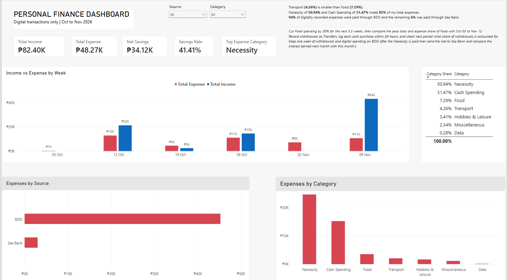
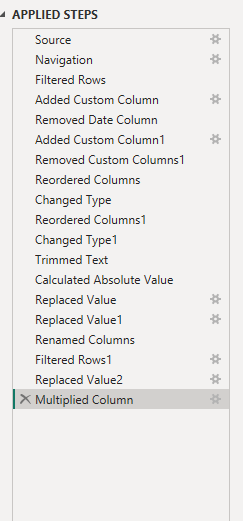
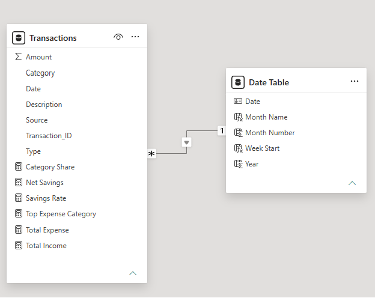

# Personal Finance Dashboard

## Project Overview
This project analyzes personal income and expense data in Power BI to identify spending patterns, savings opportunities, and financial trends. It demonstrates an end-to-end analytics workflow including data cleaning, transformation, modeling, analysis, visualization, and recommendation development using Power Query, DAX, and Power BI.

## Business Problem

Personal expenses were spread across multiple accounts and transaction types, making it difficult to understand spending behavior, measure savings performance, and identify opportunities for financial optimization.

The goal of this project was to create a dashboard that transformed raw transaction data into actionable insights and recommendations that could support financial decision-making.

## Objectives
- Track income and expenses
- Analyze spending by category
- Monitor savings performance
- Identify areas for financial improvement
- Practice an end-to-end analytics workflow

## Analytics Process
- Defined the business questions.
- Collected transaction data from bank and e-wallet records.
- Cleaned and transformed data using Power Query.
- Built a dimensional data model using a Date table and Transaction table.
- Created DAX measures for key metrics.
- Analyzed spending patterns and savings performance.
- Developed recommendations based on findings.
- Gathered stakeholder feedback to improve dashboard usability

## Competencies Demonstrated
- Cleaning and transforming data with Power Query
- Creating measures with DAX
- Identifying data quality limitations
- Turning dashboard findings into recommendations
- Using stakeholder feedback to improve usability

## Skills Demonstrated
Excel, Power Query, Data Cleaning, DAX, Power BI, Data Visualization, Data Storytelling, Data Quality Assessment

## Business Questions
- Where is the majority of spending occurring?
- Which expense categories have the greatest impact on savings?
- How much of income is being saved?
- Which spending behaviors can be optimized?
- What data collection improvements would increase reporting accuracy?

## Dashboard

## Data
- 50 transactions from my own bank and e-wallet accounts, covering October 5 to November 12, 2026
- Columns: Transaction_ID, Date, Description, Amount, Type, Category, Source
- Amounts were multiplied by a constant factor to protect privacy. Percentages and ratios are unchanged.
- Assumptions: ATM withdrawals are tracked as Cash Spending because cash purchases were not logged. Transfers between my own accounts were excluded.
- One intentionally incomplete record was added to the raw data to practice cleaning.

## Data Cleaning and Transformation (Power Query)
- Fixed mixed date formats with a custom column (culture-aware parsing)
- Trimmed text, corrected category typos, renamed Withdrawal to Cash Spending
- Converted Amount to positive values so Type decides direction
- Removed 1 incomplete record (no amount)
- Generalized descriptions that could identify a place or person

## Data model
Date Table (dimension) filtering Transactions (fact), one-to-many.

## Measures
Total Income, Total Expense, Net Savings, Savings Rate, Category Share, Top Expense Category

## Key Outcomes
- Identified that Necessity and Cash Spending accounted for approximately 82% of recorded expenses.
- Determined that untracked cash purchases were the primary data quality limitation.
- Developed recommendations to improve transaction tracking and reporting accuracy.
- Identified opportunities to optimize fund allocation between BDO and SeaBank to improve interest earnings.
- Demonstrated an end-to-end analytics workflow from data collection to recommendation development.

## Insights

**Context:** Food in this dashboard refers to discretionary foods. Necessity includes groceries that I eat at home and pack for work, and household bills that I share with my family.

### I1 (Transport)

**Observation:** Transport (4.26%) is smaller than Food (7.29%) between Oct 05 and Nov 12.

**Context:** Transport is likely undercounted since some gas and parking fees were paid in cash but were not logged.

**Why it matters:** It shows that in my logged data, Food is the largest discretionary category. Though cutting it changes total expenses only slightly.

**Action:** Reduce Food spending by 30% over the next period and compare both spending amount and category share against the baseline period

### I2 (Necessity and Cash Spending)

**Observation:** Necessity made up 50.94% of my total expenses and Cash Spending 31.47%. Together they make about 82% of my total recorded expenses between Oct 05 and Nov 12.

**Context:** Cash withdrawals were likely used to pay for some necessities, but the individual purchases weren't tracked. Untracked cash spending likely included church donations, food, gas, and parking fees.

**Why it matters:** Necessity and Cash Spending make up the largest portion of my expenses. Necessity was logged, but I do not have a detailed breakdown for Cash Spending. Until I can see the breakdown, I cannot decide where to cut.

**Action:** Record withdrawals as Transfers, log each cash purchase within 24 hours, and check next period what share of withdrawals is accounted for.

### I3 (BDO and Sea Bank)

**Observation:** 94% of digitally recorded expenses were paid through BDO and the remaining 6% through Sea Bank between Oct 05 and Nov 12.

**Context:** My salary comes through BDO. I transfer it to Sea Bank since it gives 3.5% interest per annum credited daily (Sea Bank mobile app, as of 11/16/2026). Most of my family also uses BDO, and I share bills with them, which saves me transfer fees. ATM withdrawals made up 33.57% of BDO's digital expenses.

**Why it matters:** Most of my recorded expenses went through BDO. Because of that, I can decide how much to keep in BDO and how much to keep in Sea Bank to keep earning interest.

**Action:** Keep one week of withdrawals and digital spending on BDO after the Necessity is paid, then send the rest to Sea Bank and compare the interest earned next month with this month's.

## Recommendations
1. Cut Food spending by 30% for the next 5.5 weeks, then compare the peso total and expense share of Food with Oct 05 to Nov 12.
2. Record withdrawals as Transfers, log each cash purchase within 24 hours, and check next period what share of withdrawals is accounted for.
3. Keep one week of withdrawals and digital spending on BDO after the Necessity is paid, then send the rest to Sea Bank and compare the interest earned next month with this month's.

## Key Competencies Demonstrated
## Technical Skills
- Excel
- Power Query
- Power BI
- DAX
- Data Modeling
- Data Cleaning
## Analytical Skills
- KPI Development
- Data Quality Assessment
- Root Cause Analysis
- Insight Generation
- Recommendation Development
## Communication Skills
- Dashboard Design
- Data Storytelling
- Stakeholder Feedback Collection

## Limitations
- Digital records only: cash purchases and transfers between my own accounts are not logged.
- 50 transactions (after removing 1 incomplete record) over about 5.5 weeks, so trends are thin and one payday can dominate.
- Amounts are scaled for privacy; percentages and ratios are unchanged.
- Personal data, not business data.

## Usability check
Eight informal reviewers reported that they could understand the dashboard within approximately 10 seconds.

Feedback received:

Increase the size of the chart legend (implemented).
Dashboard readability may vary depending on audience familiarity with financial concepts.

## Tools
Excel, Power Query, DAX, Power BI Desktop
